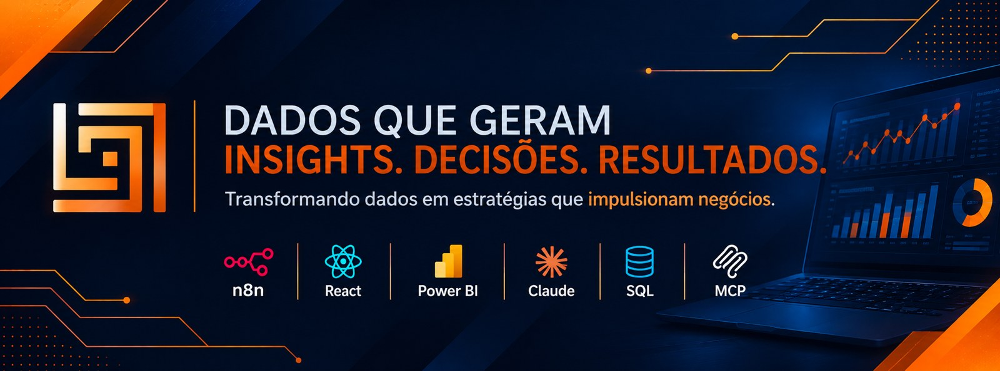

  

<h1 align="center">Luís Otávio Gonzaga</h1>
<h3 align="center">Analista de BI & Automação | Engenheiro de Produção</h3>

Transformo dados em decisões e processos manuais em fluxos automatizados com IA.

  
  
  

---

### 🧭 Sobre mim

Sou Engenheiro de Produção e especialista em Big Data. Atuo como **Analista de BI e Automação** na indústria desde 2024 e estou à frente da **Logs Dados Consultoria**, em Marialva (PR), onde ajudo empresas a tomar decisões com dados e automatizar processos que antes eram manuais.

Trabalho na ponte entre **engenharia de processos**, **análise de dados** e **inteligência artificial aplicada** — construindo desde dashboards até agentes de IA que conversam com WhatsApp, planilhas e bancos de dados.

---

### 🛠️ Stack principal

**BI & Dados**

**Automação & IA**

**Dev & Infra**

---

### 🚀 Projetos em destaque

**🏢 ERP Logs**
ERP completo de gestão: saúde da empresa, produção (planta 3D, custos e programação), manutenção, qualidade (Lean Seis Sigma), compras e cotações, armazenagem e inventário em 3D, frota e roteirização, e comercial (metas, margens e força de vendas). Conta com assistente de IA embutido (API Anthropic/Claude) que consulta os dados e executa ações via linguagem natural, e um gate de acesso para demonstrações comerciais.
[`Repositório →`](https://github.com/Logctos/logs_erp_logistica_comercial)
`React` `Vite` `TypeScript` `React Three Fiber` `Express` `Claude API`

**📍 Prospecção inteligente de clientes**
O usuário digita o que vende e a cidade. A IA identifica quais tipos de estabelecimento compram aquele produto, busca população, PIB per capita e classe estimada no IBGE e mostra no mapa os estabelecimentos reais da região (OpenStreetMap) como potenciais clientes, que podem ser convertidos em clientes dentro do ERP Logs.
`Claude API` `IBGE API` `OpenStreetMap` `Leaflet` `Express`

**🤖 BI Copilot — IA Conversacional integrada ao Power BI**
Agente corporativo que permite "conversar" com os dados do Power BI: o usuário pergunta em linguagem natural e recebe respostas e automações em tempo real. O n8n orquestra o GPT e a Power BI REST API, com uma camada de cache RAG no Supabase que atende consultas sobre 8 datasets sem refazer cada pergunta do zero.
`Power BI REST API` `n8n` `OpenAI GPT` `Supabase` `RAG`

**🏭 Manufacturing Manager — Simulador de Gestão Industrial**
Jogo de gestão em 3D para treinar diretores e gestores: o jogador administra uma fábrica de bolos industriais por 10 anos (120 meses), e cada fase libera uma área nova — produção, compras, estoque, logística, financeiro, P&D, bancos, marketing e expansão. Inclui três cenários (começar do zero, ampliar ou corrigir uma operação ruim), riscos por área com sorteio determinístico e uma "consultoria" que projeta os próximos 6 meses com os números do próprio jogador.
`React` `TypeScript` `React Three Fiber` `Vite` `Recharts` · *repositório privado, demonstração sob pedido*

**💬 Agente de Atendimento no WhatsApp**
Arquitetura de atendimento automatizado para empresas: o bot responde com IA e, quando necessário, passa a conversa para um atendente humano, com histórico centralizado no CRM. Pensado como serviço mensal da Logs Dados.
`Evolution API` `n8n` `OpenAI` `Chatwoot`

**📦 Ecossistema Inteligente de Auditoria de Estoque**
Sistema de conferência de inventário via Telegram, onde o operador audita estoque por foto ou áudio ("Corredor 1, posição R03-N2, 45 unidades"). O n8n orquestra o fluxo, o GPT-4o extrai os dados com visão computacional e Structured Outputs, e o Apps Script grava tudo em tempo real, gerando um mapa de calor de divergências. Resultado: papel zero, custo zero de hardware (qualquer smartphone vira coletor WMS).
`Telegram Bot` `n8n` `OpenAI GPT-4o` `Google Apps Script`

**🏭 PCP Agent — Agente de Programação de Produção**
Agente de IA que gera automaticamente a programação semanal da produção, cruzando capacidade fabril, carteira de pedidos e prioridades para sugerir o sequenciamento ideal — reduzindo o tempo gasto em planejamento manual no PCP.
`IA / Agente` `Automação` `PCP`

---

### 📜 Certificações

- **AI-900** — Microsoft (2026)
- **Databricks Fundamentals Accreditation** — Databricks (2026)
- **Domine a IA com Gemini** — Google (2026)
- **Fundamentos de Segurança Cibernética** — IBM (2026)
- **Claude Code na Prática: evoluindo um projeto com IA** — Asimov Academy (2026)
- **Green Belt em Lean Seis Sigma** — Grupo Voitto (2024)
- **Microsoft Power BI para Business Intelligence e Data Science** — Data Science Academy (2023)
- **Power BI Aplicado a Negócios** — Grupo Voitto (2023)
- **Analisando Vendas: KPIs** — Escola de Negócios (2023)

---

### 🎓 Formação acadêmica

- **Pós-graduação em Big Data e Análise de Dados Organizacionais** — UniCesumar (concluída em 2026)
- **Engenharia de Produção** — UNINGÁ (2021–2024)
- **Bacharelado em Engenharia Industrial** — UFPR (2018–2021)

---

### 📊 GitHub Stats

  
  

---

  📍 Marialva, Paraná, Brasil &nbsp;|&nbsp; 📱 WhatsApp (43) 99814-8076

  <i>Logs Dados Consultoria — dados que geram insights, decisões e resultados.</i>

