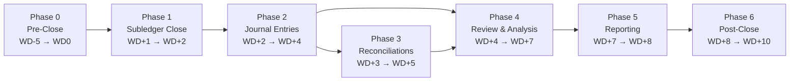

# Month-End Close Checklist

A sequenced, dependency-aware close program with built-in status tracking.

- **Scope:** single-entity or multi-entity monthly close, accrual basis.
- **Target cycle time:** results distributed by **WD+8**; stretch goal **WD+5**.
- **Convention:** `WD0` = last calendar day of the period. `WD+n` = *n*-th **business day after** period end. `WD-n` = *n*-th business day **before** period end.
- **Rule:** a task may not start until every task in its `Depends On` column is `☑ Complete`. Tasks with no dependency in the same phase run in parallel.

> **Adapt before first use.** Owner roles, thresholds, and the statutory section are placeholders. Jurisdiction-specific filings are drafted for **Brazil** in [Appendix C](#appendix-c--brazilian-statutory-obligations-optional-module); delete or replace that section if you close under a different regime. Filing deadlines shift — always confirm against the current official calendar.

---

## 1. Status vocabulary

Use exactly these markers so the checklist can be parsed, filtered, and rolled up.

| Marker | Status | Meaning |
|---|---|---|
| `☐` | Not Started | Dependencies may or may not be met; no work done. |
| `◐` | In Progress | Owner has started; on track for due date. |
| `⚠` | Blocked | Cannot proceed. **Requires a row in the [Blocker Log](#6-blocker-log).** |
| `☑` | Complete | Work done, evidence attached. Unblocks dependents. |
| `✔` | Signed Off | Reviewed and approved by someone other than the preparer. |
| `—` | N/A | Not applicable this period. Record why in the Notes column. |

**Health (RAG)** is set per phase, not per task:

| RAG | Trigger |
|---|---|
| 🟢 Green | All phase tasks on or ahead of due date. |
| 🟡 Amber | Any task ≤1 business day late, or 1 open blocker with a named path to resolution. |
| 🔴 Red | Any critical-path task late, or a blocker with no owner/ETA, or ≥3 open blockers. |

---

## 2. Phase map and critical path

### Critical path

Any slip on these tasks slips the close day-for-day. Escalate the moment one goes Amber.

**Non-critical but deadline-bound:** `JE-12` (tax provision) and `REC-08` (debt/covenants) feed `RPT-07` lender reporting, which often has a contractual date independent of the internal close.

---

## 3. The checklist

### Phase 0 — Pre-Close · WD-5 → WD0 · RAG: ⬜

Everything here happens *before* the books close. Skipping Phase 0 is the single most common cause of a slow close — it pushes cleanup work into Phase 2 where it sits on the critical path.

| ID | Task | Owner | Start | Due | Depends On | Status | Notes |
|---|---|---|---|---|---|---|---|
| PC-01 | Publish close calendar, owner assignments, and cutoff dates to all contributors | Controller | WD-5 | WD-5 | — | ☐ | |
| PC-02 | Confirm FX rate source and rate-type policy (spot vs. average) for the period | GL Accountant | WD-5 | WD-4 | PC-01 | ☐ | |
| PC-03 | Communicate AP invoice submission cutoff to business owners | AP Lead | WD-5 | WD-4 | PC-01 | ☐ | |
| PC-04 | Communicate expense report, PO receipt, and billing cutoffs | AP Lead | WD-3 | WD-3 | PC-01 | ☐ | |
| PC-05 | **Clear open workflow queues** — unapproved requisitions, POs, invoices, expense reports | AP Lead | WD-3 | WD-1 | PC-03, PC-04 | ☐ | Critical path |
| PC-06 | Finalize payroll inputs with HR — bonuses, commissions, terminations, rate changes | Payroll | WD-3 | WD-2 | PC-01 | ☐ | |
| PC-07 | Roll forward reconciliation templates; carry over prior-period open items | GL Accountant | WD-2 | WD-2 | PC-01 | ☐ | |
| PC-08 | Confirm prior-month review comments and auditor PBC items are cleared | Controller | WD-2 | WD-1 | PC-07 | ☐ | |
| PC-09 | Freeze master data — chart of accounts, cost centers, vendor/customer masters | Systems Admin | WD-1 | WD-1 | PC-01 | ☐ | |
| PC-10 | Execute inventory count / cycle-count cutoff and secure count sheets | Inventory Lead | WD-1 | WD0 | PC-01 | ☐ | |
| PC-11 | Confirm recurring/standing journal templates are current and scheduled | GL Accountant | WD-2 | WD-1 | PC-07 | ☐ | |

---

### Phase 1 — Subledger Close · WD+1 → WD+2 · RAG: ⬜

Subledgers must be closed **in this order relative to the GL**: all subledgers close before any GL-level accrual is trusted, because accruals are derived from subledger residuals.

| ID | Task | Owner | Start | Due | Depends On | Status | Notes |
|---|---|---|---|---|---|---|---|
| SL-01 | Enter final AP invoices; **close AP subledger** | AP | WD+1 | WD+1 | PC-05 | ☐ | Critical path |
| SL-02 | **GRNI analysis** — goods/services received not invoiced; produce accrual schedule | AP | WD+1 | WD+2 | SL-01 | ☐ | Critical path |
| SL-03 | Run final billing/invoicing; **close AR subledger** | AR / Billing | WD+1 | WD+1 | PC-04 | ☐ | |
| SL-04 | Apply all cash receipts through period end; clear unapplied cash | AR | WD+1 | WD+2 | SL-03 | ☐ | |
| SL-05 | Post final payroll journal, including the period-crossing partial period | Payroll | WD+1 | WD+1 | PC-06 | ☐ | |
| SL-06 | Post inventory count adjustments; run standard cost / valuation roll | Cost Accountant | WD+1 | WD+2 | PC-10 | ☐ | |
| SL-07 | Fixed assets — post additions, disposals, transfers; **run depreciation** | FA Accountant | WD+1 | WD+2 | SL-01 | ☐ | |
| SL-08 | Retrieve and import bank statements for **all** accounts, all currencies | Treasury | WD+1 | WD+1 | — | ☐ | |
| SL-09 | Close AP/AR/FA/INV subledgers in the ERP; restrict back-posting | Systems Admin | WD+2 | WD+2 | SL-01, SL-03, SL-06, SL-07 | ☐ | Gate — no subledger reopens without Controller approval |

---

### Phase 2 — Journal Entries · WD+2 → WD+4 · RAG: ⬜

All entries require: (1) a documented calculation, (2) a preparer, (3) a reviewer who is not the preparer.

| ID | Task | Owner | Start | Due | Depends On | Status | Notes |
|---|---|---|---|---|---|---|---|
| JE-01 | Load period-end and period-average FX rates into the ERP | GL Accountant | WD+1 | WD+1 | PC-02 | ☐ | |
| JE-02 | **Accrue unbilled expenses / GRNI accrual** | GL Accountant | WD+2 | WD+3 | SL-02 | ☐ | Critical path |
| JE-03 | Payroll and benefits accruals — bonus, PTO/vacation, commissions, employer taxes | GL Accountant | WD+2 | WD+3 | SL-05 | ☐ | |
| JE-04 | Prepaid expense amortization | GL Accountant | WD+2 | WD+3 | SL-01 | ☐ | |
| JE-05 | Revenue cutoff — deferred revenue, unbilled AR, contract asset/liability | Revenue Accountant | WD+2 | WD+3 | SL-03, SL-04 | ☐ | |
| JE-06 | Lease accounting — ROU asset amortization and lease liability interest | GL Accountant | WD+2 | WD+3 | SL-07 | ☐ | |
| JE-07 | Allowance for credit losses / bad debt provision | AR | WD+3 | WD+3 | SL-04 | ☐ | |
| JE-08 | Inventory reserves — excess & obsolete, lower of cost or NRV, shrink | Cost Accountant | WD+3 | WD+3 | SL-06 | ☐ | |
| JE-09 | Intercompany matching, settlement, and elimination entries | GL Accountant | WD+3 | WD+3 | JE-01, SL-09 | ☐ | |
| JE-10 | FX revaluation of monetary assets and liabilities; CTA to equity | GL Accountant | WD+3 | WD+4 | JE-01, JE-09 | ☐ | |
| JE-11 | **Cost allocations** — overhead, shared services, intercompany service charges | Cost Accountant | WD+3 | WD+4 | JE-02, JE-03, JE-04, JE-06 | ☐ | Critical path |
| JE-12 | Income tax provision — current and deferred, ETR true-up | Tax | WD+5 | WD+6 | RV-06 | ☐ | Needs a stable pre-tax number |
| JE-13 | Share-based compensation expense | GL Accountant | WD+2 | WD+3 | — | ☐ | |
| JE-14 | **Post top-side / adjusting entries arising from review** | Controller | WD+6 | WD+7 | RV-06, JE-12 | ☐ | Critical path · Each entry needs a written rationale |

---

### Phase 3 — Reconciliations · WD+3 → WD+5 · RAG: ⬜

Every balance sheet account is assigned to exactly one reconciliation. **Preparer ≠ reviewer** on all rows. Reconciling items older than 60 days require a written remediation plan.

| ID | Task | Owner | Start | Due | Depends On | Status | Notes |
|---|---|---|---|---|---|---|---|
| REC-01 | Bank reconciliations — every account, every currency | Treasury | WD+3 | WD+3 | SL-08, SL-04 | ☐ | |
| REC-02 | AP subledger-to-GL tie-out; review debit balances and aged items | AP | WD+3 | WD+4 | SL-09 | ☐ | |
| REC-03 | AR subledger-to-GL tie-out; aging review and credit-balance analysis | AR | WD+3 | WD+4 | SL-09 | ☐ | |
| REC-04 | Inventory subledger-to-GL tie-out and quantity/value roll-forward | Cost Accountant | WD+4 | WD+4 | SL-09, JE-08 | ☐ | |
| REC-05 | Fixed asset register-to-GL tie-out; cost and accumulated depreciation roll-forward | FA Accountant | WD+4 | WD+4 | SL-09, SL-07 | ☐ | |
| REC-06 | Accrual and prepaid schedules agreed to GL balances | GL Accountant | WD+4 | WD+4 | JE-02, JE-03, JE-04 | ☐ | |
| REC-07 | Intercompany balances confirmed and netted to zero across entities | GL Accountant | WD+4 | WD+4 | JE-09 | ☐ | |
| REC-08 | Debt and interest schedules; assemble covenant calculation inputs | Treasury | WD+4 | WD+5 | REC-01 | ☐ | |
| REC-09 | Equity roll-forward — issuances, buybacks, share-based comp, CTA | GL Accountant | WD+4 | WD+4 | JE-13, JE-10 | ☐ | |
| REC-10 | Payroll liability and payroll tax clearing accounts | Payroll | WD+4 | WD+4 | JE-03 | ☐ | |
| REC-11 | **All suspense and clearing accounts cleared to zero** | GL Accountant | WD+5 | WD+5 | REC-01 … REC-10 | ☐ | Hard gate — a non-zero clearing account blocks RPT-01 |
| REC-12 | Reconciliation review and sign-off; log aged open items | Controller | WD+5 | WD+5 | REC-11 | ☐ | ✔ required |

---

### Phase 4 — Review & Analysis · WD+4 → WD+7 · RAG: ⬜

| ID | Task | Owner | Start | Due | Depends On | Status | Notes |
|---|---|---|---|---|---|---|---|
| RV-01 | **Generate preliminary trial balance** | GL Accountant | WD+4 | WD+5 | JE-11, JE-10 | ☐ | Critical path |
| RV-02 | Balance sheet flux vs. prior month — explain movements over threshold | FP&A | WD+5 | WD+5 | RV-01 | ☐ | Threshold: ±10% **and** ±[amount] |
| RV-03 | P&L flux — actual vs. budget, prior month, prior year | FP&A | WD+5 | WD+6 | RV-01 | ☐ | Threshold: ±5% **and** ±[amount] |
| RV-04 | Gross margin, unit economics, and headcount-cost review | FP&A | WD+5 | WD+6 | RV-03 | ☐ | |
| RV-05 | Cash flow statement (indirect); tie ending cash to bank recs | GL Accountant | WD+6 | WD+6 | RV-01, REC-01 | ☐ | |
| RV-06 | **Controller review of trial balance; issue adjustment list** | Controller | WD+6 | WD+6 | RV-02, RV-03, REC-12 | ☐ | Critical path · ✔ required |
| RV-07 | CFO review of draft results and flux commentary | CFO | WD+7 | WD+7 | RV-06, JE-14 | ☐ | ✔ required |

---

### Phase 5 — Reporting · WD+7 → WD+8 · RAG: ⬜

| ID | Task | Owner | Start | Due | Depends On | Status | Notes |
|---|---|---|---|---|---|---|---|
| RPT-01 | **Final trial balance; soft-lock the period** | Controller | WD+7 | WD+7 | JE-14, REC-11 | ☐ | Critical path |
| RPT-02 | Consolidation and elimination run; validate translation | GL Accountant | WD+7 | WD+7 | RPT-01, REC-07 | ☐ | Multi-entity only |
| RPT-03 | **Draft financial statements** — BS, IS, CF, statement of equity | Controller | WD+7 | WD+8 | RPT-02 | ☐ | Critical path |
| RPT-04 | Disclosure and footnote support schedules | Controller | WD+8 | WD+8 | RPT-03 | ☐ | |
| RPT-05 | Management reporting pack; refresh KPI dashboards | FP&A | WD+8 | WD+8 | RPT-03, RV-04 | ☐ | |
| RPT-06 | **Distribute results to leadership / board** | CFO | WD+8 | WD+8 | RPT-05, RV-07 | ☐ | Critical path — close is *done* here |
| RPT-07 | Lender / investor reporting and covenant compliance certificate | Treasury | WD+8 | WD+8 | RPT-03, REC-08 | ☐ | Check contractual due date |

---

### Phase 6 — Post-Close · WD+8 → WD+10 · RAG: ⬜

The phase most often skipped, and the only one that makes next month faster.

| ID | Task | Owner | Start | Due | Depends On | Status | Notes |
|---|---|---|---|---|---|---|---|
| PST-01 | Hard-close the GL period; restrict posting rights | Systems Admin | WD+8 | WD+8 | RPT-01 | ☐ | |
| PST-02 | Archive close evidence — reconciliations, approvals, JE support | GL Accountant | WD+9 | WD+9 | RPT-04 | ☐ | |
| PST-03 | Tag and file internal-control (SOX/ICFR) evidence | Compliance | WD+9 | WD+9 | PST-02 | ☐ | |
| PST-04 | Update the open-items / carry-forward log for next period | Controller | WD+9 | WD+9 | PST-02, REC-12 | ☐ | Feeds PC-07 next month |
| PST-05 | Close retrospective — cycle time, late tasks, root causes | Controller | WD+10 | WD+10 | PST-04 | ☐ | |
| PST-06 | Update close calendar and automation backlog for next period | Controller | WD+10 | WD+10 | PST-05 | ☐ | Feeds PC-01 next month |

---

## 4. Sign-off matrix

The close is not complete until every row below is signed.

| Deliverable | Preparer | Reviewer | Approver | Date | Status |
|---|---|---|---|---|---|
| Subledger close complete (SL-09) | | | Controller | | ☐ |
| All journal entries posted and reviewed (JE-01…JE-14) | | | Controller | | ☐ |
| All balance sheet reconciliations (REC-12) | | | Controller | | ☐ |
| Flux analysis and commentary (RV-06) | | | Controller | | ☐ |
| Draft financial statements (RPT-03) | | | CFO | | ☐ |
| Period hard-closed (PST-01) | | | Controller | | ☐ |

---

## 5. Close scorecard

Record each month; trend it in the retrospective (PST-05).

| Metric | Target | This period | Prior period | Trend |
|---|---|---|---|---|
| Days to distribute results (WD+n) | ≤ 8 | | | |
| Tasks completed on or before due date | ≥ 95% | | | |
| Post-review top-side adjustments (JE-14 count) | ≤ 3 | | | |
| Value of top-side adjustments | ≤ materiality | | | |
| Reconciliations with items aged > 60 days | 0 | | | |
| Unreconciled clearing-account balance at RPT-01 | 0 | | | |
| Blockers raised | ≤ 2 | | | |
| Reopened periods after PST-01 | 0 | | | |

---

## 6. Blocker Log

Every `⚠ Blocked` task needs a row here. No ETA means the phase goes 🔴 Red.

| # | Task ID | Raised | Description | Blocking dependency | Owner | ETA | Escalated to | Resolved |
|---|---|---|---|---|---|---|---|---|
| 1 | | | | | | | | |

---

## Appendix A — Dependency reference

Reverse index: *"if this task slips, what stops?"*

| Task | Directly blocks |
|---|---|
| PC-05 | SL-01 |
| SL-01 | SL-02, SL-07, SL-09, JE-04 |
| SL-02 | JE-02 |
| SL-03 | SL-04, SL-09, JE-05 |
| SL-09 | JE-09, REC-02, REC-03, REC-04, REC-05 |
| JE-02 | JE-11, REC-06 |
| JE-09 | JE-10, REC-07 |
| JE-11 | RV-01 |
| REC-11 | REC-12, RPT-01 |
| REC-12 | RV-06 |
| RV-01 | RV-02, RV-03, RV-05 |
| RV-06 | JE-12, JE-14 |
| JE-14 | RPT-01 |
| RPT-01 | RPT-02, PST-01 |
| RPT-03 | RPT-04, RPT-05, RPT-07 |
| RPT-05 | RPT-06 |

## Appendix B — Compressing the close

Applied roughly in order of return on effort:

1. **Move work into Phase 0.** Cutoff enforcement (PC-05) and template rollover (PC-07) cost nothing on the critical path and remove days from Phase 2.
2. **Accrue on estimates, not on invoices.** If GRNI (SL-02) gates the close, switch immaterial categories to a run-rate accrual with a true-up in the following period.
3. **Reconcile continuously.** Bank (REC-01) and intercompany (REC-07) can be reconciled daily/weekly, leaving only the last few days at close.
4. **Parallelize Phase 3 against Phase 2.** Reconciliations for accounts with no pending entry do not need to wait for the full JE batch.
5. **Set a materiality floor for flux commentary.** RV-02/RV-03 expand without bound unless thresholds are enforced.
6. **Automate the repeatable.** Recurring entries (JE-04, JE-06, JE-13) and subledger-to-GL tie-outs (REC-02…REC-05) are rule-based and should not consume analyst time.
7. **Cap top-side adjustments.** A high JE-14 count is a symptom that review is happening too late; push detection into Phase 3.

## Appendix C — Brazilian statutory obligations (optional module)

Runs **in parallel** with Phases 3–6 and does not gate the internal close, but shares source data with it. Deadlines below are the common cases — several vary by state, municipality, and taxpayer regime, and they change. **Verify against the current official calendar each period.**

| ID | Obligation | Owner | Typical deadline | Depends On | Status |
|---|---|---|---|---|---|
| BR-01 | Conciliação de notas fiscais (NF-e / NFS-e / CT-e) contra faturamento | Fiscal | WD+3 | SL-03 | ☐ |
| BR-02 | Apuração de ICMS / IPI | Fiscal | Varies by state | BR-01 | ☐ |
| BR-03 | Apuração de PIS / COFINS | Fiscal | WD+5 | BR-01 | ☐ |
| BR-04 | Apuração de ISS e retenções municipais | Fiscal | Varies by municipality | BR-01 | ☐ |
| BR-05 | Apuração de IRPJ / CSLL (mensal ou trimestral, conforme regime) | Fiscal | Per regime | RV-06 | ☐ |
| BR-06 | eSocial — eventos periódicos de folha | Payroll | Monthly, per official calendar | SL-05 | ☐ |
| BR-07 | EFD-Reinf | Fiscal | Monthly, per official calendar | SL-01 | ☐ |
| BR-08 | DCTFWeb | Fiscal | Monthly, per official calendar | BR-06, BR-07 | ☐ |
| BR-09 | SPED Fiscal — EFD ICMS/IPI | Fiscal | Varies by state | BR-02 | ☐ |
| BR-10 | EFD-Contribuições | Fiscal | Monthly, per official calendar | BR-03 | ☐ |
| BR-11 | Livros contábeis e razão do período arquivados | Contabilidade | WD+9 | PST-02 | ☐ |
| BR-12 | ECD — Escrituração Contábil Digital *(anual)* | Contabilidade | Annual | BR-11 (Dec close) | — |
| BR-13 | ECF — Escrituração Contábil Fiscal *(anual)* | Fiscal | Annual | BR-12 | — |

---

*Machine-readable task list for import into a tracker: [`month-end-close-tasks.csv`](./month-end-close-tasks.csv).*
